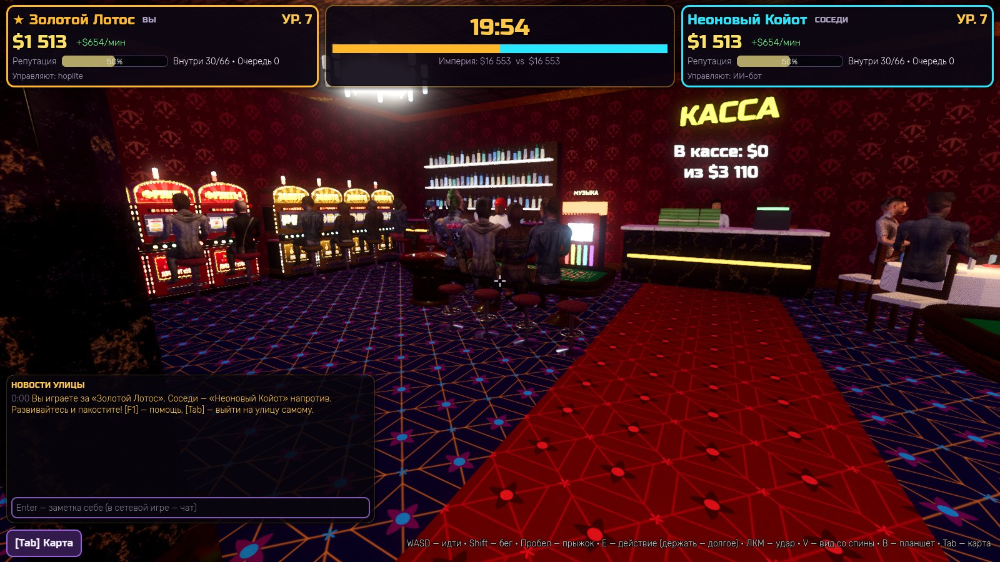
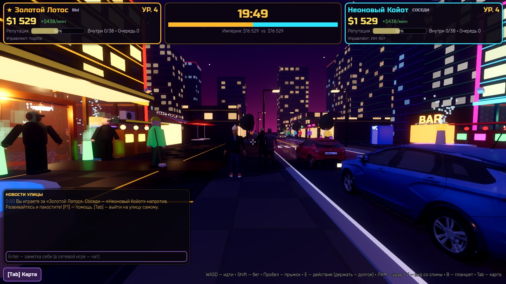
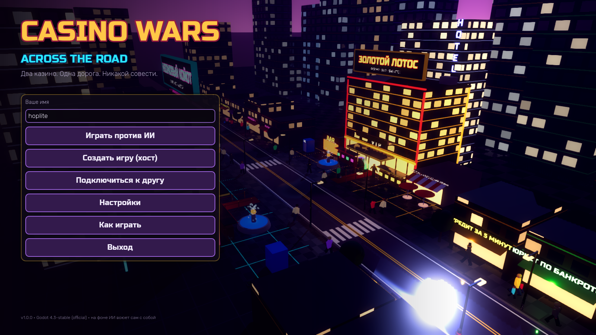
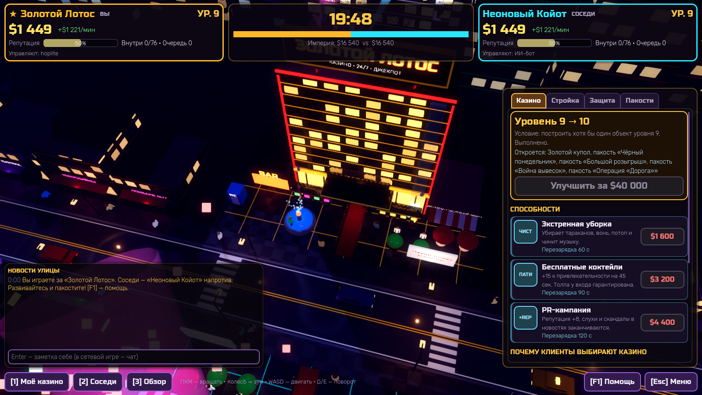
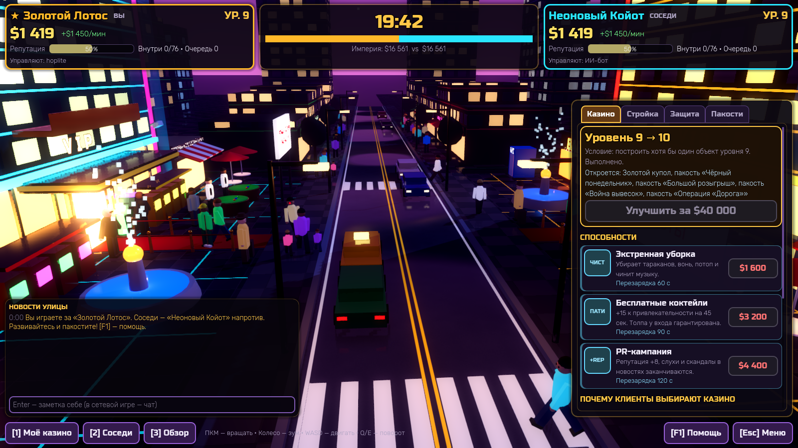

# Casino Wars: Across the Road

Два казино стоят друг напротив друга через узкую дорогу. Развивайте своё, переманивайте клиентов и пакостите соседу: тараканы, фейковые слухи, подкуп таксистов, «Чёрный понедельник» и ремонт дороги прямо перед его входом.

3D-игра на **Godot 4** (GDScript). Режимы: против ИИ, **1 на 1** и **2 на 2** по сети (Radmin VPN, Hamachi, LAN).

Играть можно двумя способами и переключаться в любой момент клавишей **Tab**:
- **Карта (стратегия):** камера сверху, стройка, найм, пакости через «пульт».
- **«Хозяин» (от первого лица):** выйдите на улицу сами. Забирайте выручку из кассы, своими руками выгоняйте тараканов, суйте соседу тухлую рыбу в кондиционер, обчищайте его кассу, раздавайте прохожим флаеры и раздавайте подзатыльники. Внутри казино настоящий зал: автоматы, рулетка, блэкджек, бар, гости и крупье. Режим собран из лучшего, что было в **Jackpot Hotel** (персонажи, автоматы, столы, машины, звуки, музыка).

> Скриншоты сняты программным рендером (без видеокарты). На обычном ПК картинка чище.

---

## Как запустить

1. Скачайте **Godot 4.3 или новее** (проверено на 4.3 и 4.7.2): <https://godotengine.org/download>. Нужна обычная версия, не .NET.
2. Скачайте этот проект (Code → Download ZIP) и распакуйте.
3. В Godot нажмите **Импорт** и выберите файл `project.godot` в распакованной папке.
4. Нажмите **F5** (▶ «Запустить проект»).

При первом открытии Godot несколько минут импортирует текстуры, звуки и шрифты (их несколько сотен). Это нормально, повторно ждать не придётся.

**Чтобы раздать друзьям готовый .exe:** в Godot выберите «Проект → Экспорт», добавьте пресет Windows Desktop (Godot предложит скачать шаблоны экспорта) и нажмите «Экспортировать проект». У всех игроков должна быть **одна и та же версия** игры.

## Игра с друзьями через Radmin VPN

1. Все устанавливают **Radmin VPN** и заходят в одну сеть (один создаёт сеть, остальные подключаются по имени и паролю).
2. **Хост:** «Создать игру (хост)» → «Создать». В лобби показаны ваши IP-адреса, адрес Radmin выглядит как `26.x.x.x` и подсвечен. Его можно скопировать кнопкой и отправить друзьям.
3. **Друзья:** «Подключиться к другу», ввести IP хоста и нажать «Подключиться».
4. В лобби хост выбирает режим (**1 на 1** или **2 на 2**), длительность и сложность ИИ. Каждый выбирает себе казино. Пустые места займёт ИИ, так что можно играть 2 против 1 или 1 против ИИ по сети.
5. Хост нажимает **«Начать матч»**.

Если не подключается:
- Хост должен **разрешить Godot (или exe игры) в брандмауэре Windows**: при первом создании игры появится запрос. Порт по умолчанию — **7777/UDP**.
- Проверьте, что в Radmin у всех зелёный статус, а пинг до хоста проходит.
- Сообщение «Разные версии игры» значит, что у кого-то старая копия проекта.

Если игрок отключается посреди матча, его казино подхватывает ИИ.

## Управление

| Действие | Клавиши |
|---|---|
| Вращать камеру | ПКМ + мышь, Q / E |
| Двигать камеру | WASD / стрелки, СКМ + мышь |
| Зум | колесо мыши |
| Моё казино / соседи / обзор | 1 / 2 / 3 |
| Чат | Enter |
| Помощь | F1 |
| Меню (настройки, сдаться, выход) | Esc |
| **Карта ↔ «Хозяин» (от первого лица)** | **Tab** |

**В режиме «Хозяин»:**

| Действие | Клавиши |
|---|---|
| Идти / бежать / прыгнуть | WASD, Shift, пробел |
| Действие (касса, флаер); держать — долгое действие (починка, пакость, кража) | E |
| Подзатыльник | ЛКМ |
| Вид от третьего лица | V |
| Планшет со стройкой, защитой и пакостями | B |

Строительство, найм, пакости и способности делаются через вкладки справа. Наверху всегда видны деньги, репутация, уровень, посетители и активные эффекты, свои и соседа.

---

## Геймдизайн-документ (кратко)

**Жанр:** симулятор и стратегия в реальном времени, соседская война с чёрным юмором.
**Цель:** к концу таймера иметь «Империю» больше соседской (деньги + 60% вложений + репутация × 300) или довести соседа до банкротства (минус $2000 дольше 45 секунд).

### Улица и клиенты
По тротуарам ходят люди, по дороге ездят машины и такси. Машины тормозят перед пешеходами на зебре. Каждый прохожий выбирает, куда зайти, сравнивая казино по факторам:
- фасад (здания и уровень), музыка, запахи, комфорт;
- репутация, слухи, акции, длина очереди;
- «сочувствие публики» к отстающему.

Разбор этих факторов для своего казино и соседа показан во вкладке «Казино».

| Клиент | Особенности |
|---|---|
| Обычный | основа дохода |
| VIP | тратит в 5 раз больше, не терпит очередей и плохой репутации, любит VIP-зону и лифт |
| Пьяный | идёт в бар, не чувствует вони, может опозорить казино |
| Семья | любит ресторан, туалет и фонтан, ненавидит тараканов |
| Шулер | ворует деньги, избегает камер и охраны |
| Скандалист | появляется только от пакости «Скандалисты» |

Люди говорят реплики («Проиграл ипотеку. Кайф!», «Фу, там тараканы!») и стоят в очереди у входа.

### Развитие (10 уровней)
Каждый уровень делает здание выше и поднимает ставки. Для повышения нужен хотя бы один объект текущего уровня.

| Ур. | Объекты |
|---|---|
| 1 | Игровые автоматы, бар «Последняя рюмка», туалет |
| 2 | Неоновая вывеска, музыкальная система |
| 3 | Аромат «Запах денег», фонтан желаний, золотые автоматы |
| 4 | Ресторан «Последний ужин» |
| 5 | Отель «Не уйдёшь» |
| 6 | VIP-зона |
| 7 | Живые крупье |
| 8 | Шоу «Танцующие должники» на крыше |
| 9 | Стеклянный лифт в пентхаус, салют |
| 10 | Золотой купол и Тотальные саботажи |

Каждый объект появляется на улице как 3D-модель с анимацией.

### Пакости
| Тип | Пакости |
|---|---|
| Лёгкие (ур. 1–3) | Тараканы, вонючка, порча музыки, фейковые слухи, подкуп таксистов |
| Средние (ур. 4–6) | Скандалисты (идут к соседу и устраивают сцену), поломка туалетов и лифта, фальшивые деньги |
| Тяжёлые (ур. 7–9) | Подкуп крупье (минус 8% денег соседа), скандал в новостях (фургон ТВ у входа), массовый уход (ложная пожарная тревога) |
| Тотальные (ур. 10) | Чёрный понедельник (туча и ливень, доход −70%), Большой розыгрыш (толпа идёт к вам), Война вывесок, Операция «Дорога» (ремонт с экскаватором перед входом соседа) |

**Риск:** у каждой пакости есть шанс поимки, который растёт от защиты соседа. Если поймали — штраф 50% цены, минус репутация, у соседа появляется **«Ответный удар»**: следующая пакость за полцены и без риска.

### Защита и способности
- **Защита:** камеры, чистильщик, охрана, юрист, контр-пропаганда, детектив. У каждой есть содержание в минуту. Одни ловят пакостников, другие смягчают удары. Детектив находит улики, даже если пакостника не поймали.
- **Способности:** «Экстренная уборка», «Бесплатные коктейли», «PR-кампания».

### Режимы и роли
- **Против ИИ:** три уровня сложности. ИИ строится, копит на уровни, нанимает защиту, пакостит и мстит.
- **1 на 1** и **2 на 2** по сети. В 2 на 2 двое делят одно казино и общий кошелёк. Можно включить роли:
  - **Директор:** стройка и улучшения на 10% дешевле.
  - **Пакостник:** пакости на 15% дешевле, ловят на 7% реже.
- Фоном в главном меню идёт живой матч ИИ против ИИ.

### Режим «Хозяин» (от первого лица)
Каждый игрок — ещё и человек на улице. Остальные игроки видят вас (имя и цвет команды над головой).
- **Касса.** 30% выручки зала копится в кассе у дальней стены. Подойдите и нажмите E, чтобы деньги ушли в сейф. Полная касса больше не копит, так что ходить за деньгами приходится.
- **Починка руками.** Тараканы — у дверей, вонь — у кондиционера, испорченная музыка — у щитка, потоп — у двери WC. Держите E: бесплатно и +1 к репутации.
- **Пакости руками.** У казино соседа: тараканы под дверь, тухлая рыба в кондиционер, перемкнуть щиток. Вдвое дешевле пульта, но если рядом стоит игрок соседа, риск поимки +30%. Поймали — штраф, а охрана вышвыривает вас на дорогу.
- **Касса соседа.** Держите E у его кассы, чтобы унести половину. Ловят камеры, охрана и детектив.
- **Флаер прохожему** ($15): человек разворачивается и идёт к вам, даже если шёл к соседу.
- **Подзатыльник (ЛКМ).** Прохожий убегает, а если он стоял в очереди, у казино падает репутация. Игрок соседа после трёх ударов лежит в нокауте 5 секунд.
- **Дорога.** Машины сигналят и тормозят, но зазевавшегося собьют.
- Вблизи прохожие — живые персонажи с анимацией, издалека — лёгкие фигурки, чтобы улица не тормозила.

---

## Технический стек и архитектура

- **Godot 4.3+, GDScript, рендер Forward+** (в Godot 4.4+ на видеокартах без Vulkan игра сама перейдёт на OpenGL; если тормозит — в настройках есть «Низкое» качество). Улица, казино и эффекты строятся кодом, шейдерами (окна небоскрёбов, мокрый асфальт, бегущие огни, звёздное небо) и процедурными звуками. Шрифты Russo One и Rubik распространяются по лицензии OFL (`fonts/`).
- **Из Jackpot Hotel** (`scripts/kit/`, `assets/`): персонажи со скелетом и ~50 анимациями, фото-люди, автоматы, рулетка, блэкджек, плинко, бар и мебель, машины «Матиз», Suzuki Swift и Lada Vesta, текстуры, звуки (шаги, касса, удары) и музыка. Исходники ассетов восстановлены из собранной игры: текстуры в PNG, звуки в WAV, музыка в OGG. При первом открытии Godot импортирует их пару минут.
- **Сеть:** ENet, хост-авторитетная модель. Хост симулирует улицу, экономику и ИИ. Клиенты отправляют только запросы («построить», «пакость», «забрать кассу»), хост проверяет и применяет их. Позиции людей и машин упакованы по 12 байт и отправляются порциями меньше MTU, поэтому нормально идут через VPN. Позиции игроков от первого лица идут 20 раз в секунду.

| Файл | Назначение |
|---|---|
| `scripts/autoload/defs.gd` | все данные: здания, защита, пакости, клиенты, реплики, настройки |
| `scripts/autoload/game.gd` | симуляция матча, экономика, пакости, режим «Хозяин», ИИ, синхронизация |
| `scripts/autoload/net.gd` | лобби, подключение, команды и роли |
| `scripts/autoload/sfx.gd` | процедурные звуки, звуки и музыка из `assets/audio` |
| `scripts/autoload/assets.gd` | материалы и текстуры для китов Jackpot Hotel |
| `scripts/fp/fp_player.gd` | игрок от первого лица: движение, камера, действия, нокаут |
| `scripts/world/hall.gd` | зал казино: касса, автоматы и столы по мере стройки, персонал, гости |
| `scripts/world/*` | 3D: улица, казино, люди, машины, камера, хелперы шейдеров |
| `scripts/kit/*` | киты Jackpot Hotel: персонажи, автоматы, столы, мебель, машины |
| `scripts/ui/*` | тема, HUD матча |
| `scripts/menu.gd`, `scripts/match.gd` | сцены меню и матча |
| `scripts/dev.gd` | автотесты, включаются только флагом `-- --dev` (`--fptest` прогоняет режим «Хозяин») |

## План разработки

- [x] **MVP:** камера, два казино, дорога, клиенты, стройка, экономика.
- [x] Пакости с риском поимки, защита, ответный удар, способности.
- [x] ИИ-соперник (3 уровня сложности), баланс проверен ускоренными матчами ИИ против ИИ.
- [x] Сеть 1 на 1 и 2 на 2, роли, лобби, чат, замена отключившихся на ИИ.
- [x] Интерфейс, звуки, настройки графики, экран итогов.
- [x] Режим «Хозяин» от первого лица: зал казино с автоматами и столами, касса, починка и пакости руками, кража, флаеры, драки, машины. Персонажи, машины, звуки и музыка из Jackpot Hotel.
- [ ] Следующие шаги: этажи выше первого (отель, VIP, пентхаус), ИИ-соперник тоже ходит по улице, мини-игры за столами, больше событий (налоговая проверка, визит мэра), сохранение статистики.
